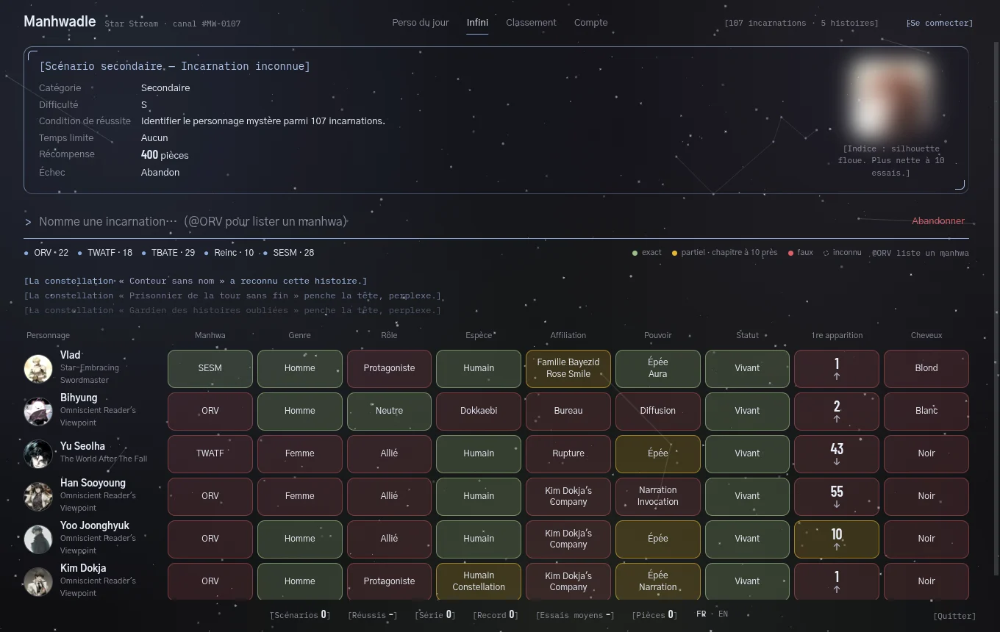
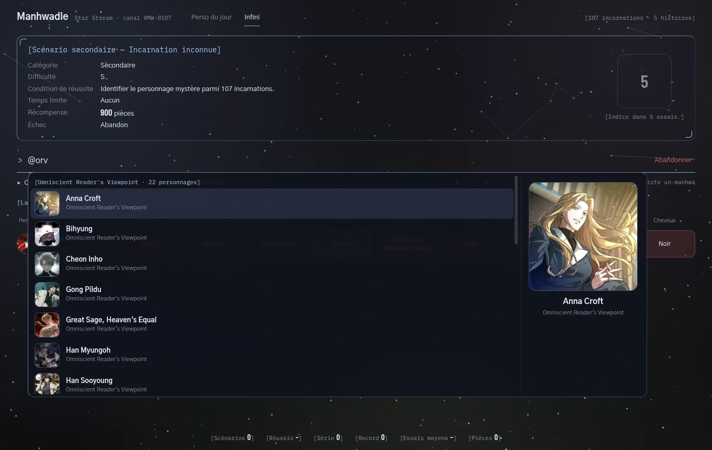

# Manhwadle

> [Un nouveau scénario est arrivé.]
>
> **Condition de réussite :** identifier l'incarnation mystère.
> **Échec :** ???

Manhwadle est un jeu de déduction standalone (Electron), dans la veine des « -dle ». Le but : retrouver
un personnage de manhwa. À chaque essai, ton personnage est comparé au personnage mystère sur
9 catégories, et les constellations du Star Stream commentent ta progression.



**Histoires disponibles** — 107 incarnations :

| Tag | Manhwa | Persos |
|---|---|---|
| `@ORV` | Omniscient Reader's Viewpoint | 22 |
| `@TWATF` | The World After The Fall | 18 |
| `@TBATE` | The Beginning After The End | 29 |
| `@Reinc` | Reincarnator | 10 |
| `@SESM` | Star-Embracing Swordmaster | 28 |

---

## Le scénario

Deux modes, présentés comme des scénarios du Star Stream :

- **Scénario principal — Le personnage du jour** : la même incarnation pour tout le monde, tirée parmi
  les 107. Le temps limite est minuit, heure locale.
- **Scénario secondaire — Incarnation inconnue** : mode infini. Tu choisis les histoires en jeu ;
  plus il y en a, plus la difficulté monte (de D à S).

La fenêtre de scénario affiche la catégorie, la difficulté, la condition de réussite, le temps
limite, la récompense et l'échec. L'indice (une silhouette floutée) se débloque à 6 essais et
devient presque net à 10.

**Récompense** : 1 000 pièces au premier essai, puis 100 de moins par essai supplémentaire
(100 au minimum). Les pièces s'additionnent dans tes statistiques.

### Lecture des cases

| Case | Signification |
|---|---|
| Verte | même valeur |
| Jaune | au moins une valeur en commun, ou chapitre à 10 près |
| Rouge | aucune valeur en commun |
| Pointillés | donnée encore inconnue : pas de verdict |

Les 9 catégories : manhwa, genre, rôle, espèce, affiliation, pouvoir, statut, chapitre de
1re apparition dans le webtoon (une flèche indique s'il faut viser plus tôt ou plus tard),
cheveux.

### Nommer une incarnation



- Tape un nom : la recherche ignore les accents et place en tête les noms qui commencent par ta saisie.
- `@` liste les manhwa ; `@ORV` liste tous les persos d'ORV pas encore proposés ; `@ORV kim`
  cherche uniquement dans ORV. Un début de tag suffit (`@tb`, `@rein`, `@stellar`).
- Le grand aperçu à droite de la liste montre le portrait du personnage surligné.
- Clavier : ↑ ↓ pour naviguer, Entrée pour valider, Tab pour compléter un tag, Échap pour fermer.

### Les constellations

À chaque essai, une constellation réagit selon le nombre de cases justes : de « bâille » à
« retient son souffle ». Les constellations sont inventées pour le jeu.

---

## Direction artistique

La base est **« Verre d'encre »** (`Docs/DA/DA-Verre-d-encre.md`) : jetons de couleur bleu-nuit,
accent unique `#8aa8e0`, polices Gothic A1 / Barlow Condensed / IBM Plex Mono, rouge, jaune et
vert réservés aux verdicts.

Le jeu l'interprète librement, dans l'ambiance d'ORV :

- **Fenêtre transparente** : sous Hyprland (Caelestia), le fond d'écran flouté passe à travers.
  Un voile léger garde le texte lisible.
- **Pas de gros panneaux** : onglets texte, recherche en simple ligne, essais posés sur le fond.
- **Une seule fenêtre système**, celle du scénario : liseré bleu, coins en équerre, fond presque
  transparent.
- **Ton « roman »** : messages système entre crochets, en mono (`[Échec du scénario.]`).
- **Ciel de constellations** animé discrètement, et reflet du curseur sur la fenêtre de scénario.

---

## Lancer le jeu

```bash
npm install
npm install-scripts approve electron   # npm ≥ 12 bloque les scripts d'installation
npm start
```

Exécutable Linux : `npm run dist` → `dist/Manhwadle-<version>.AppImage` (nécessite `fuse2`).

## Commandes

| Commande | Rôle |
|---|---|
| `npm start` | lance le jeu |
| `npm test` | logique du jeu, validation des données, portraits sans doublon |
| `npm run dist` | construit l'AppImage |
| `npm run portraits:galerie` | page des portraits manquants, à enregistrer depuis le navigateur |
| `npm run portraits:import` | importe `assets/inbox/<id>.<ext>` en portraits WebP |

### Outils de développement

- **Capture hors écran** : `npx electron tools/screenshot.cjs capture.png endless kim-dokja,vlad`
  (`TYPE="@orv"` pré-remplit la recherche, `SKIP=1` abandonne la partie).
- **Mode démo du build** : `MANHWADLE_DEMO="kim-dokja,vlad" MANHWADLE_TYPE="@orv" ./Manhwadle.AppImage`
  rejoue des essais. Il ne touche ni aux parties ni aux statistiques du joueur.

## Workflow git

- `main` : versions validées (protégée, PR obligatoire)
- `dev` : intégration (protégée, PR obligatoire, branche par défaut)
- `feature/<sujet>` : une branche par feature, PR vers `dev`
